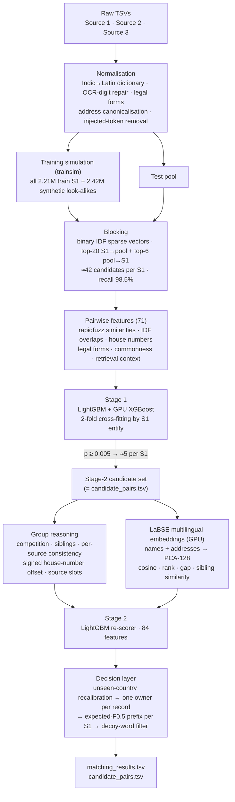

<div align="center">

# Business Entity Resolution at Scale
### Amazon ML Challenge 2026 · Team Zephyrus

Matching **1.73 M** business entities against **9.97 M** noisy records from two other sources, across the US, India and
France (a country that never appears in training).


</div>

---

## TL;DR

* **Task:** for every Source-1 (S1) business, find *all* Source-2/3 records that describe the same real-world business.
  Scored with **macro F0.5 per S1 entity** (precision counts twice as much as recall; an entity with no true match only
  scores if we predict nothing).
* **Solution:** a precision-first, fully data-driven pipeline:
  learned normalisation → two-directional sparse retrieval → two-stage gradient boosting with *group reasoning* →
  multilingual (LaBSE) similarity → an expected-F0.5 decision layer under a "one owner per record" constraint.
* **Two ideas carried the result:**
  1. **A test-faithful training set.** Unlabelled statistics showed that ~20 % of the test pool are *planted look-alike
     businesses* (same name, house number a few doors away). We reproduced that signature synthetically in training
     (2.42 M generated decoy records), so the models learned to reject them.
  2. **Language-agnostic embeddings for an unseen country.** LaBSE name/address similarity features let what was learned
     on US/India transfer to French data: **+0.0011 on the leaderboard for only +0.0004 on US/India validation**.
* **Result:** public leaderboard **0.977874**, validation macro F0.5 **0.98623** (US 0.98705 · India 0.98500).
  Everything runs on one laptop: 16 GB RAM and an RTX 3050 (6 GB). The full pipeline takes about 8 hours.

---

## Table of contents

1. [The problem](#1-the-problem)
2. [What the data told us](#2-what-the-data-told-us)
3. [Architecture](#3-architecture)
4. [Pipeline in detail](#4-pipeline-in-detail)
5. [Results](#5-results)
6. [What did not work](#6-what-did-not-work)
7. [Error analysis](#7-error-analysis)
8. [Post-competition review: what we would do next](#8-post-competition-review-what-we-would-do-next)
9. [Repository structure](#9-repository-structure)
10. [Reproducing the results](#10-reproducing-the-results)
11. [Tech stack and licences](#11-tech-stack-and-licences)
12. [Team](#12-team)

---

## 1. The problem

Three sources describe businesses with name, address and country. Source 1 is the reference list; Sources 2 and 3 are noisy
copies plus records of businesses that do not exist in Source 1.

| | Train | Test |
|---|---|---|
| Source-1 entities | 2,206,821 (US, India) | 1,732,544 (India 0.81 M, US 0.66 M, **France 0.26 M**) |
| Source-2 + Source-3 records | 10.32 M | 9.97 M |
| Pool records per S1 entity | 4.68 | **5.75** |
| True pairs | 7,638,365 (3.46 per entity; 5.6 % of entities have none) | hidden |

**Metric.** For each S1 entity, F0.5 between the predicted and true sets of matching records, then averaged over entities.
A singleton (no true match) scores 1 only for an empty prediction. One wrong match on a singleton costs the full point.

**Deliverables.** `matching_results.tsv` (one row per S1 entity with its matched ids) and `candidate_pairs.tsv` (every pair
the final model scored; each predicted match must be in it, which is checked by the official validator).

**Rules that shaped the design:** no external data, APIs or geocoders; models ≤ 8 B parameters with MIT/Apache-2.0
licences; France appears **only in test**, with no labels.

---

## 2. What the data told us

Most design decisions came from exploratory analysis, not from model tuning.

| Finding | Evidence | Consequence |
|---|---|---|
| Names are ambiguous | ~50 % of S1 entities share their normalised name with another S1 entity | the address, and especially the **house number**, decides |
| Indic scripts are word-by-word transliterations | ~20 % of Indian pool names are in 9 Indic scripts; token counts agree with the English name 99.999 % of the time | an **exact Indic→Latin dictionary learned from training pairs** |
| Noise is generated, not natural | OCR digits are exactly `0→o 1→l 5→s 8→b 6→g`; injected legal forms, honorifics, alias constructions, domains; null tokens in addresses | targeted, data-learned normalisation |
| One base record per source | in 91.8 % of (business, source) groups all copies share one house number; a deviating number is shared within the source 65 % of the time but across sources only 12 % | **group features**: a record that agrees with the entity's other records is likely genuine |
| **The test pool differs from train** | 5.75 vs 4.68 records per S1; blank-address, domain and alias rates in test are all **0.80×** train, while cosmetic noise is unchanged | ≈20 % of the test pool are *planted* look-alikes that never get heavy noise → **synthesise them for training** |
| Look-alikes sit a few doors away | measured on test marker-word records: same number 14 %, ±1–2 16 %, ±3–10 35 %, ±11–100 21 % | decoy generator draws offsets from this distribution |
| France behaves differently | among confident French matches the house number differs in only **0.9 %** of pairs (US 13 %, India 6 %) | label-free **noise-rate recalibration** for unseen countries |

---

## 3. Architecture



### The funnel

| Step | Training simulation | Test |
|---|---|---|
| Source-1 entities | 2,206,821 | 1,732,544 |
| Pool records | 12.74 M (10.32 M + 2.42 M synthetic decoys) | 9.97 M |
| Blocking candidates | 92.4 M pairs (41.9 per S1, recall 0.9852) | 72.9 M pairs (≈42 per S1) |
| Stage-1 survivors (p ≥ 0.005) | 11.16 M pairs | **8.59 M pairs (4.96 per S1)** |
| Predicted matches | — | 5.86 M pairs (3.38 per S1; 94.3 % of S1 entities non-empty) |

Reduction ratio against all same-country pairs: > 0.999999.

---

## 4. Pipeline in detail

### 4.1 Normalisation — `text_norm.py`, `prepare.py`, `learn_translit.py`

* **Indic scripts:** `learn_translit.py` aligns Indic-script pool names with the English names of their true S1 matches,
  token by token, and stores an exact dictionary (plus native-script state names). `anyascii` is only a fallback for
  tokens never seen in training.
* **Names:** NFKD accent folding, OCR-digit repair inside words, canonical legal forms (`pvt ltd`, `llc`, `sarl` …),
  removal of honorifics (`mr`, `dr`, `sri`, `shri`, `smt`), alias markers (`dba`, `aka`, `fka`) and filler words into a
  *core name*, glued variants for split tokens and web domains, acronyms of the core and full name.
* **Addresses:** one canonical short form per abbreviation (`street→st`, `boulevard/bd→blvd`, `rue→r`), ordinals and leading
  zeros stripped, digits split from letters (`419Bonny → 419 bonny`), null tokens removed, state tables per country.
* **Injected address tokens:** found *unsupervised* by comparing token frequencies between Source 1 and the pool per
  country, then removed.
* Country is treated as an **open set**: any country without training data (France) goes through the generic path.

### 4.2 A test-faithful training set — `make_sim.py`, `make_decoys.py`

Training on the raw training split teaches the model that look-alikes differ *in the name*. On test they mostly differ *in
the house number*, so a model trained on raw train data accepts them. We therefore rebuilt the training pool:

* keep **all** training S1 entities (`BER_KEEP_FRAC=1.0`) so the candidate-list features (counts, ranks, margins) have the
  same density as a real search;
* for 73.5 % of S1 entities (`BER_DECOY_RATE=0.85` of eligible), create a **decoy business** with 1–3 records
  (probabilities 0.50/0.35/0.15). Its records copy genuine records of that business, move the house number by an offset
  drawn from the measured test distribution, and sometimes add a sister-company word (`holdings`, `westgate`,
  `infratech` …);
* donors exclude domain-name and alias records, so the final pool reproduces the test signature exactly: **5.77 records
  per S1** (test 5.75), with blank-address, domain and alias rates at 0.80× train.

All training, validation and threshold choices use this `trainsim` split. Adversarial validation (a classifier
separating test from validation candidate pairs) reaches only **AUC 0.565** for the US, so the simulation is close to test.

### 4.3 Candidate generation (blocking) — `blocking.py`

* **Vectors per country:** binary IDF-weighted sparse vectors over core-name unigrams and bigrams, address unigrams and
  bigrams (house numbers included), name character 4-grams (weight 0.5) and **composite name-token × house-number keys**
  (weight 1.0, which recovers records whose address is truncated to a number and city).
* **Two directions:** `sparse_dot_topn` top-20 S1→pool **and** top-6 pool→S1, so every pool record meets its own best S1
  candidates even when the S1 has many look-alikes.
* **Memory-lean:** chunked CSR construction under a global string cache so 12.7 M records fit in 16 GB RAM.
* **Recall:** 0.9852 on trainsim (US 0.9869, India 0.9827) at 41.9 candidates per S1.

### 4.4 Pairwise features (71) — `features.py`, `build_features.py`

| Group | Examples |
|---|---|
| Name similarity | rapidfuzz ratio / token-sort / token-set / partial / Jaro-Winkler on core name; glued name (domains, splits); full name with legal form; sorted-token Levenshtein; acronym match |
| Address similarity | rapidfuzz on full address and on the *core* address (per-country frequent tokens removed) |
| IDF overlaps | weighted overlap from each side, weighted Jaccard, common-token count, max IDF of shared tokens, missing IDF mass |
| House numbers | count and first number on both sides, equality, digit edit distance, containment, absolute and length difference |
| Record flags | domain-style name, alias construction, Indic-script name, blank address, source, unseen-token share (generated names), marker words absent from S1 |
| Legal form | agreement, missing on either side |
| Commonness | frequency of the name/address in Source 1 and in the pool |
| Retrieval context | blocking cosine, rank in both lists, list sizes, gap to the best S1 / best record, margin |

Vectorised with Polars + rapidfuzz `cdist`/`cpdist` and Numba, processed in chunks.

### 4.5 Stage 1 — `train_lgb.py`, `train_xgb.py`, `predict_test.py`

* LightGBM (CPU) and XGBoost (`device="cuda"`, trained on a 22 % sample to fit the 6 GB GPU), averaged.
* **2-fold cross-fitting by S1 entity**, so every training pair gets an out-of-fold probability for stage 2 and validation.
* Stage 1 also acts as a **learned second blocker**: pairs with p ≥ 0.005 go to stage 2 (≈5 per S1). This set is
  exactly `candidate_pairs.tsv`.

### 4.6 Stage 2: reasoning about groups of records — `stage2.py`, `train_stage2.py`

A pair is judged together with every other record that claims the same S1 entity, and every other S1 entity the same record
could belong to.

| Feature family | Idea |
|---|---|
| Competition (`g_*`) | rank of this S1 among the record's owners, best competing owner, margin, probability mass on both sides |
| Sibling agreement (`sib_*`) | similarity to the S1's most confident other records, overall and **within the same source** (copies of one business share a per-source base record) |
| Consistency (`cs_*`) | how many other records of the S1 share this record's house number / name variant / address core, split into **same-source** and **other-source** support |
| Signed offset (`cs_num_sdiff`, `cs_num_srel`) | house-number difference *with sign* relative to the entity's other records: the direction carries signal (US training: offsets of −1…−2 are 85 % true, +1…+2 only 16 %) |
| Source slots (`sl_*`) | 92 % of non-singleton entities have at least one copy per source, so a second strong record in an already-filled slot is suspicious |

### 4.7 Multilingual similarity with LaBSE — `emb_encode.py`, `emb_pairs.py`, `emb_sib.py`, `stage2_emb.py`

* Every normalised name (9.8 M) and address (12.85 M) in a stage-2 pair is encoded with
  [`sentence-transformers/LaBSE`](https://huggingface.co/sentence-transformers/LaBSE) (Apache-2.0, 471 M parameters) in fp16 on
  the laptop GPU (≈85 min for the addresses), L2-normalised and reduced to **128 dims with PCA** (stored as float16).
* Stage-2 features for names and addresses: **cosine**, its **rank and gap** among the S1's candidates and among the
  record's competing owners, and (names) **sibling similarity**: the cosine to the S1's top-3 confident other records,
  overall and within the same source.
* These features are language-independent, so they transfer from US/India to Indic-script names and to the unseen French
  data. They cut stage-2 log-loss by ~5 % and moved the leaderboard 2.5× more than US/India validation.

### 4.8 Decision layer — `recalibrate.py`, `decide.py`, `postfilter.py`, `make_submission.py`

1. **Unseen-country recalibration.** The matcher learned from US/India how often a *true* copy carries a different house
   number (~10 %). For a country without labels we measure the same rate on its confident matches (France 0.88 %) and
   scale the odds of number-mismatch pairs by $r_{country}/r_{train}$ (France ≈ 0.088). This is a likelihood-ratio
   correction that needs no labels.
2. **One owner per record.** In training no record belongs to two S1 entities. Each record's candidate owners compete against a
   "no owner" option:

   $$q_i = \frac{o_i}{1 + \sum_j o_j}, \qquad o_i = \frac{p_i}{1-p_i}$$

   and only the best owner is kept.
3. **Expected-F0.5 set selection.** Per S1, sort candidates by $q$ and choose the prefix $k$ that maximises

   $$\mathbb{E}[F_{0.5}] \approx \frac{(1+\beta^2)\sum_{j\le k} q_j}{\beta^2\,\mathbb{E}|G| + k}, \qquad \beta = 0.5$$

   compared with predicting nothing, which is worth $P(\text{no match}) = \prod_j (1-q_j)$.
4. **Decoy-word filter.** A selected pair is dropped when the record carries a sister-company marker word the S1 name lacks
   (words learned from training labels, where every such selected pair was a false positive).

---

## 5. Results

### 5.1 Validation (trainsim, out-of-fold, owner + expected-F0.5 decision)

| Model | India | US | All |
|---|---|---|---|
| Stage 1: LightGBM | 0.97544 | 0.97949 | 0.97787 |
| Stage 1: LightGBM + XGBoost | — | — | 0.97814 |
| Stage 2: group reasoning | 0.98440 | 0.98665 | 0.98575 |
| + LaBSE name features | — | — | 0.98613 |
| + LaBSE sibling similarity | 0.98494 | 0.98702 | 0.98619 |
| **+ LaBSE address features (final)** | **0.98500** | **0.98705** | **0.98623** |

The decision rule matters too: on stage 1, a plain 0.5 threshold scores 0.97461. Exclusivity raises that to 0.97594,
one-owner to 0.97688, and one-owner + expected-F0.5 to **0.97787**.

### 5.2 Leaderboard history (14 submissions)

| Version | What changed | Public LB |
|---|---|---|
| v1 | Stage-1 LightGBM, first normalisation and blocking | 0.970443 |
| v2 | + stage-2 re-scorer (competition and sibling features) | 0.973196 |
| v3 | + removal of French "groupe / développement" words | 0.972680 ↓ |
| v4 | Blocking, normalisation and feature upgrades | 0.974386 |
| v5 | + France house-number recalibration | 0.974815 |
| v7 | Decoy-aware training, LightGBM + XGBoost ensemble | 0.975781 |
| probe | v7 with every French prediction emptied | 0.842796 |
| v10 | + French recall additions (base-mates, acronyms) | 0.975499 ↓ |
| v12 | Test-faithful simulation, learned second blocker, signed-offset and source-slot features | 0.976662 |
| v14 | 3-model stage-2 ensemble + France-only normalisation | 0.975909 ↓ |
| P1 | v12 − French pairs with a different house number | 0.976050 |
| P2 | v12 − French pairs with an added marker word | 0.976007 |
| s12n | v12 + LaBSE name and sibling features | 0.977756 |
| **s12a** | **+ LaBSE address features (final)** | **0.977874** |

**Probing France.** France is 15 % of test and has no labels, so we used controlled uploads that change only French rows.
The emptied-France probe gave *France F0.5 − French singleton rate = 0.888*, which puts France at ≈0.94 vs ≈0.98 for
US/India. P1/P2 showed that the specific French pairs we suspected were in fact correct, and the France-only
normalisation (v14) lowered the score. So the French rules were switched off, and the language-agnostic LaBSE
features became our France lever.

The full experiment journal, including every rejected idea, is in [`docs/EXPERIMENTS.md`](docs/EXPERIMENTS.md).

---

## 6. What did not work

| Idea | Outcome |
|---|---|
| Hand-written boost/penalty rules on top of the model | −0.0001 … −0.0009 validation |
| "One house-number cluster per source" filter | −0.003 validation |
| Stage 3 (another re-scorer on stage-2 output) | ±0.0000 |
| Per-S1 entity-count / empty-entity model | ±0.0000 |
| 3-model stage-2 ensemble (LightGBM + XGBoost + LightGBM) | +0.00006 validation, not worth the complexity |
| Identical-name sibling rule | 42 % precision |
| "Sole occupant" rule (accept a record that has only one candidate S1) | would add ~150 k false positives on validation |
| France-only normalisation of injected words (uploaded with the 3-model ensemble) | −0.00075 leaderboard |
| Removing French "groupe / développement" records | −0.0005 leaderboard: those words are noise, not decoy markers |

---

## 7. Error analysis

Loss decomposition on validation (2.2 M S1 entities, `src/analysis/loss_by_group.py`):

* **After stage 1:** 331 k missed true pairs vs only 33 k false merges. The main causes were house-number noise (155 k) and
  blank addresses (132 k).
* **After stage 2:** 172 k misses (blank address 115 k, house-number noise 29 k, generated replacement names 16 k) plus
  113 k never retrieved by blocking, vs 18 k false merges.
* **Typical false positives:** planted businesses at a nearby house number, co-located businesses with a swapped category
  word, single-record look-alikes of singleton S1 entities.
* **Typical false negatives:** copies with blank or truncated addresses and very common names, where nothing in the record
  says which of several identically named S1 entities it belongs to.

---

## 8. Post-competition review: what we would do next

After the results we compared our pipeline with a public top-50 solution
([Paradox-73/Business_Entity_Resolution](https://github.com/Paradox-73/Business_Entity_Resolution), LB 0.9906).
Their gradient-boosting stage scored *lower* on the leaderboard than ours (0.9700 vs 0.9767), so the gap came from
three components we did not build:

| Component | Their measured gain | Our status |
|---|---|---|
| **Fine-tuned cross-encoders** (e5-small → bge-reranker-v2-m3) re-reading the 23.5 % uncertain records | +0.007 validation, ≈+0.013 leaderboard | we used *frozen* LaBSE embeddings as features (+0.001) |
| **Label-free France rules**: a lowercase-rate test from a generator quirk, a descriptor-word veto, a legal-form veto, "transformers may only lower French probabilities" | France ≈0.95 → ≈0.98 | probes only; the rules we tried were the wrong subsets |
| **Blocking audit at full density**: document-frequency cap 4 k → 20 k, wider no-address search, dense retrieval | recall 0.985 → 0.996 (+0.003) | recall 0.985, the same cap problem |
| Second pipeline + stacker | +0.0005 | single pipeline |

The first three fit on the same class of hardware we used. Our next steps, in order:

1. fix the document-frequency caps and re-measure recall at full density;
2. add a fine-tuned multilingual cross-encoder as stage 3 for close calls;
3. derive France rules from label-free tests and validate each one with a France-only upload.

Details: [`docs/LESSONS_LEARNED.md`](docs/LESSONS_LEARNED.md).

---

## 9. Repository structure

```
.
├── README.md                          ← you are here
├── code/business_entity_resolution/
│   ├── README.md                      step-by-step run guide (17 steps, commands and outputs)
│   ├── requirements.txt               pinned dependencies
│   ├── run_pipeline.sh                raw TSVs → both submission files → official validator
│   └── src/
│       ├── config.py                  paths (BER_DATA / BER_WORK / BER_OUTPUT), threads
│       ├── convert.py                 TSV → parquet
│       ├── learn_translit.py          Indic → Latin dictionary from training pairs
│       ├── text_norm.py, prepare.py   normalisation, unsupervised injected-token removal
│       ├── make_sim.py, make_decoys.py  test-faithful training set with synthetic look-alikes
│       ├── blocking.py                two-directional sparse IDF retrieval
│       ├── features.py, build_features.py  71 pairwise features
│       ├── train_lgb.py, train_xgb.py, predict_test.py  stage 1
│       ├── stage2.py, train_stage2.py group-reasoning re-scorer
│       ├── emb_encode.py, emb_complete.py, emb_pairs.py, emb_sib.py  LaBSE embeddings and features
│       ├── stage2_emb.py              final stage-2 model
│       ├── recalibrate.py, decide.py, postfilter.py  decision layer
│       ├── make_submission.py, write_outputs.py  submission files
│       ├── metric.py, eval_oof.py     macro F0.5 and validation report
│       ├── package_submission.py      builds the competition archive
│       └── analysis/                  25 diagnostic and experiment scripts (loss decomposition,
│                                      adversarial validation, rule ablations, leaderboard probes)
├── docs/
│   ├── METHODOLOGY.md                 methodology write-up submitted with the solution
│   ├── EXPERIMENTS.md                 experiment journal: every version, score and decision
│   ├── FEATURES.md                    full feature catalogue (stage 1 and stage 2)
│   └── LESSONS_LEARNED.md             post-competition review
└── experiments/
    ├── runs/                          orchestration scripts as run during the competition
    ├── logs/                          their logs (training, validation, timings)
    └── feature_lists/                 exact feature lists of the trained models
```

The competition dataset, intermediate files (~150 GB) and submission files are not part of the repository.

---

## 10. Reproducing the results

```bash
git clone https://github.com/GeekSomesh/Amazon-ML-Challenge-2026.git
cd Amazon-ML-Challenge-2026
pip install -r code/business_entity_resolution/requirements.txt   # Python 3.11; CUDA build of torch
# place the competition data in dataset/train and dataset/test (or set BER_DATA)
bash code/business_entity_resolution/run_pipeline.sh
```

* Outputs: `output/matching_results.tsv` and `output/candidate_pairs.tsv`. Intermediate files go to `work/`.
* Paths can be overridden with `BER_DATA`, `BER_WORK`, `BER_OUTPUT`, and threads with `BER_THREADS`.
* If the official `validate_submission.py` is placed in `utils/`, the script runs it at the end.
* Every step, its command and its output are listed in
  [`code/business_entity_resolution/README.md`](code/business_entity_resolution/README.md).
* `python eval_oof.py <tag>` (from `src/`) prints the validation report of any out-of-fold file.

**Reference machine:** Windows 11, 16 logical cores, 16 GB RAM, NVIDIA RTX 3050 Laptop GPU (6 GB); full run ≈ 8 hours.
A re-run reproduces the leaderboard files up to minor numerical differences (multi-threaded tree training, GPU floating
point, nearest-neighbour tie-breaking).

---

## 11. Tech stack and licences

| Component | Use | Licence |
|---|---|---|
| Polars, PyArrow, NumPy, SciPy | columnar data processing, sparse matrices | MIT / Apache-2.0 / BSD |
| rapidfuzz, anyascii, Numba | string similarity, transliteration fallback, JIT kernels | MIT / ISC / BSD |
| sparse_dot_topn | top-k sparse matrix products for blocking | Apache-2.0 |
| LightGBM, XGBoost (CUDA) | stage-1 and stage-2 models | MIT / Apache-2.0 |
| PyTorch, sentence-transformers, LaBSE | multilingual embeddings (471 M parameters) | BSD / Apache-2.0 / Apache-2.0 |

Only the provided training and test files are used: no external data, look-ups or APIs.

---

## 12. Team

**Team Zephyrus**, Bangalore Institute of Technology (BIT), Bangalore

| Member |
|---|
| [Somesh Srivastava](https://github.com/GeekSomesh) |
| Naina Agarwal |
| Paraj Prasad |
| Harshitha Jagannath |

Built for the **Amazon ML Challenge 2026** (September 2026). Thanks to the organisers for a well-designed and genuinely
hard entity-resolution problem.
